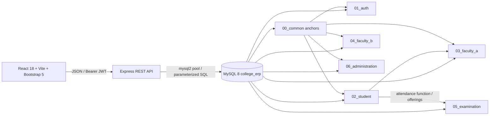

# System architecture

The SQL build defines all schema, constraints, functions, procedures, triggers, views and seeds. `database/run_all.sh` applies each phase across modules in dependency order; JavaScript does not create schema objects. Express validates requests, authenticates users with bcrypt/JWT, applies role and owner checks, and uses parameterized reads plus the database's procedures for business operations. Vite proxies `/api` to the backend in development. Configure the same local MySQL database and root `.env` before starting the API.

## Verification environment

Record actual commands/results in the submission report. The checked-in `database-verification.log` records the prior baseline passing common/auth/student and Faculty A schema/routine/trigger phases; it does not verify later modules.
